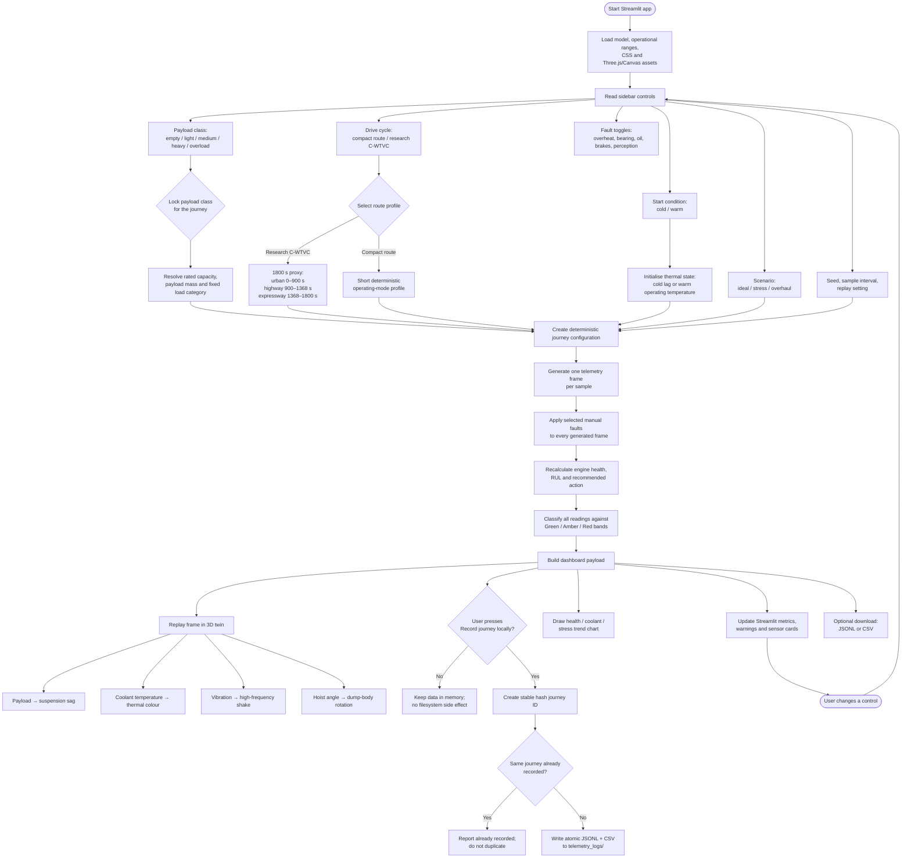
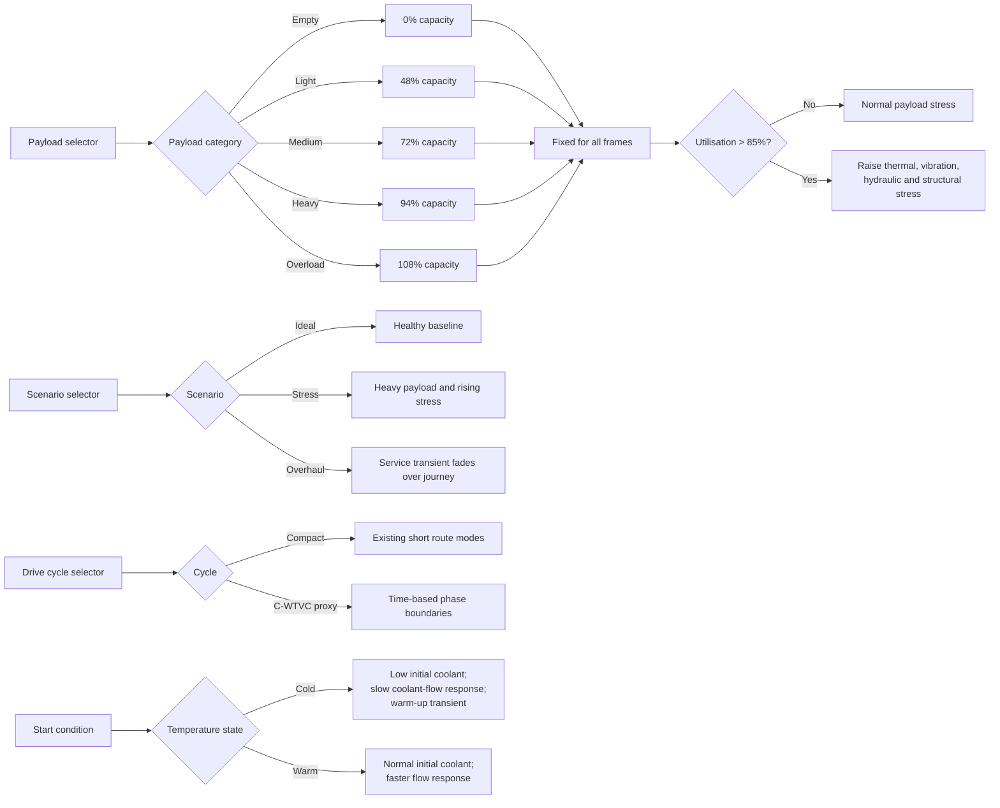
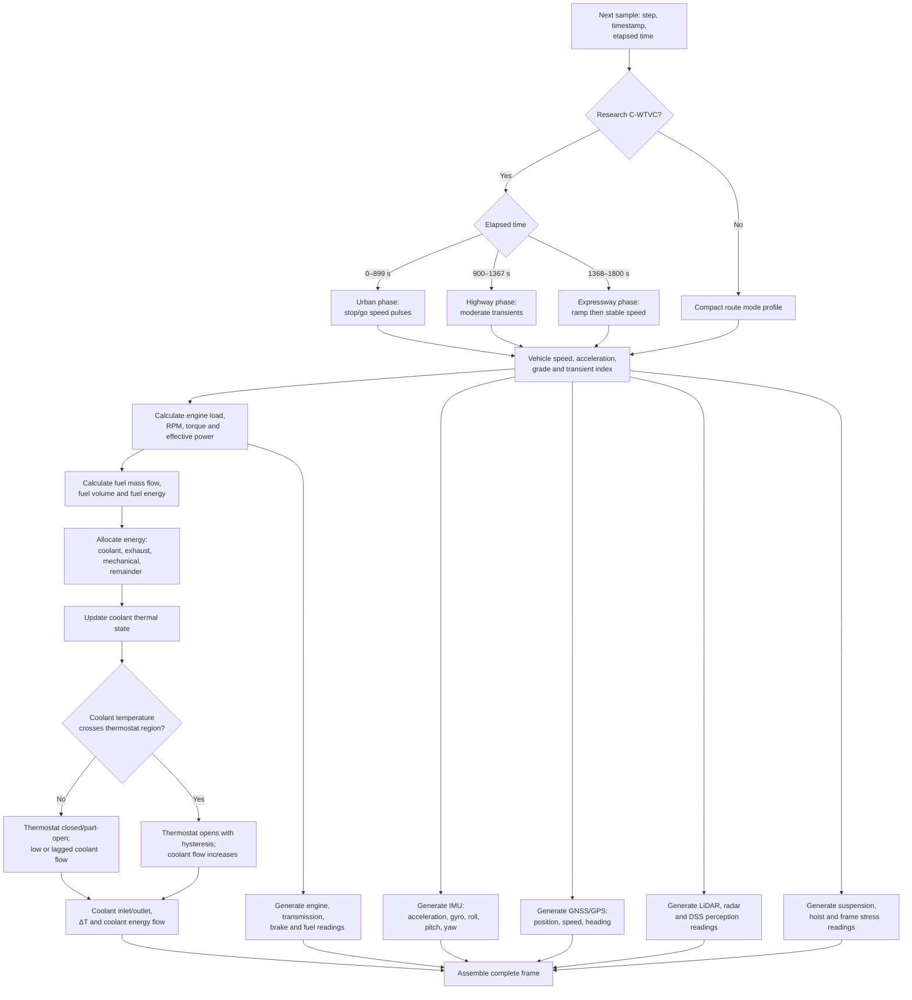
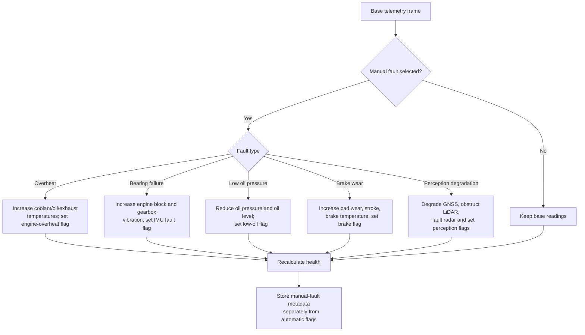
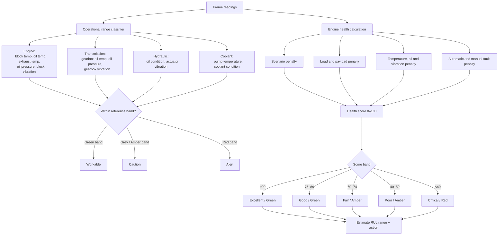
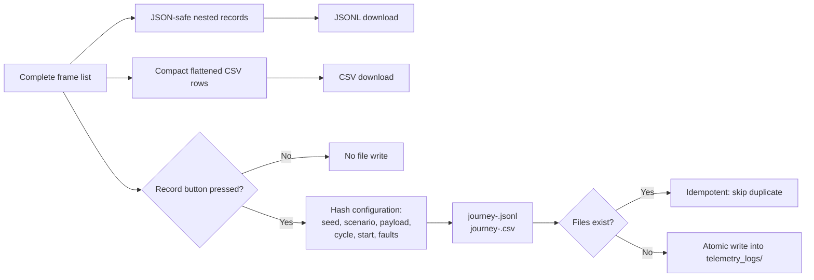

# Dump-truck digital twin — complete decision flow

The diagrams below describe the complete working of the Streamlit simulator:
input controls, journey-level decisions, per-sample telemetry generation,
fault injection, operational-band decisions, engine-health decisions, 3D
mapping, and explicit logging/export.

> The research cycle is a deterministic C-WTVC proxy calibrated from the
> supplied Fuel 328 (2022) paper and figures. It is not the authors' raw data.

## 1. Whole application flow

## 2. Journey-level decisions

## 3. Per-sample telemetry decision flow

## 4. Fault injection flow

## 5. Operational-range and health decisions

## 6. Output and persistence flow

## Operational-range reference used by the model

| System | Green / workable | Grey / amber / caution | Red / alert |
|---|---|---|---|
| Engine block temperature | 82–101 °C | 101–108 °C; values 78–82 °C are uncovered and treated cautiously | >108 °C or <78 °C |
| Engine oil temperature | 86–100 °C | 100–106 °C | >106 °C |
| Exhaust temperature | 340–555 °C | 555–615 °C | >615 °C |
| Engine oil pressure | 459–512 kPa | 440–459 or 512–525 kPa | <440 or >525 kPa |
| Engine block vibration | 2.0–6.3 mm/s | 6.3–7.5 mm/s | >7.5 mm/s |
| Gearbox oil temperature | 67–89 °C | 89–96 °C | >96 °C |
| Transmission oil pressure | 329–372 kPa | 310–329 or 372–390 kPa | <310 or >390 kPa |
| Gearbox vibration | 1.4–5.0 mm/s | 5.0–6.0 mm/s | >6.0 mm/s |
| Hydraulic oil condition | ≥90 | 80–90 | <80 |
| Hydraulic actuator vibration | 1.6–5.3 mm/s | 5.3–6.3 mm/s | >6.3 mm/s |
| Coolant pump temperature | 78–92 °C | 92–98 °C | >98 °C |
| Coolant condition | ≥90 | 80–90 | <80 |

The classifier is conservative: a value in an uncovered gap is reported as
amber rather than incorrectly reported as healthy.
