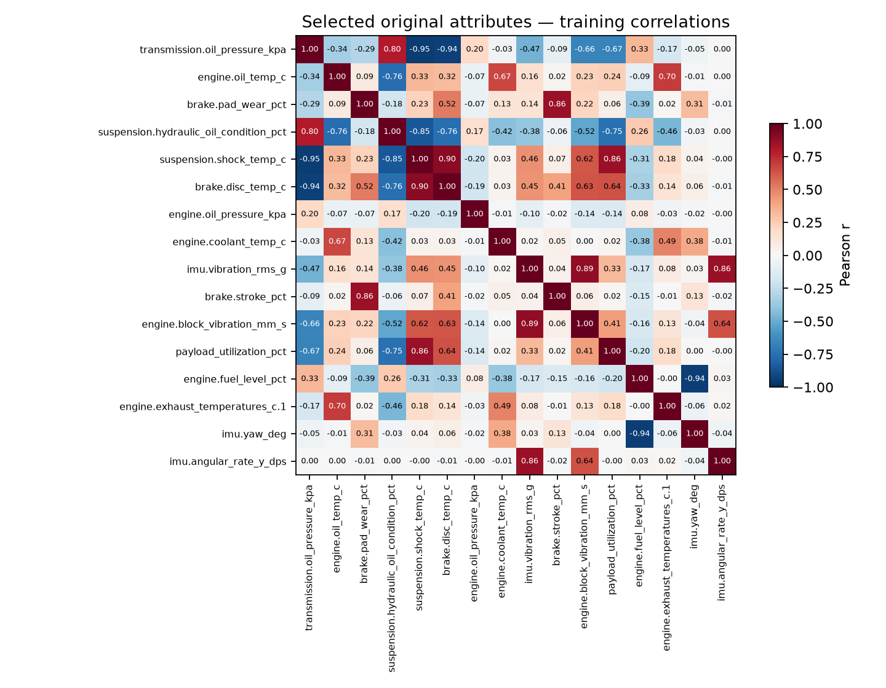
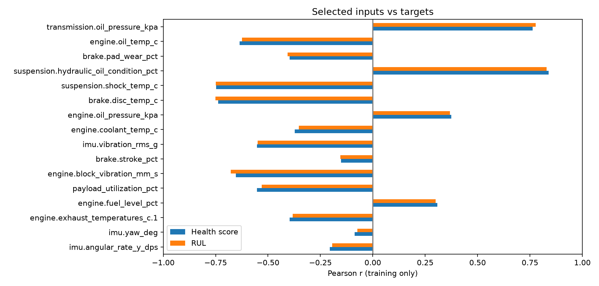
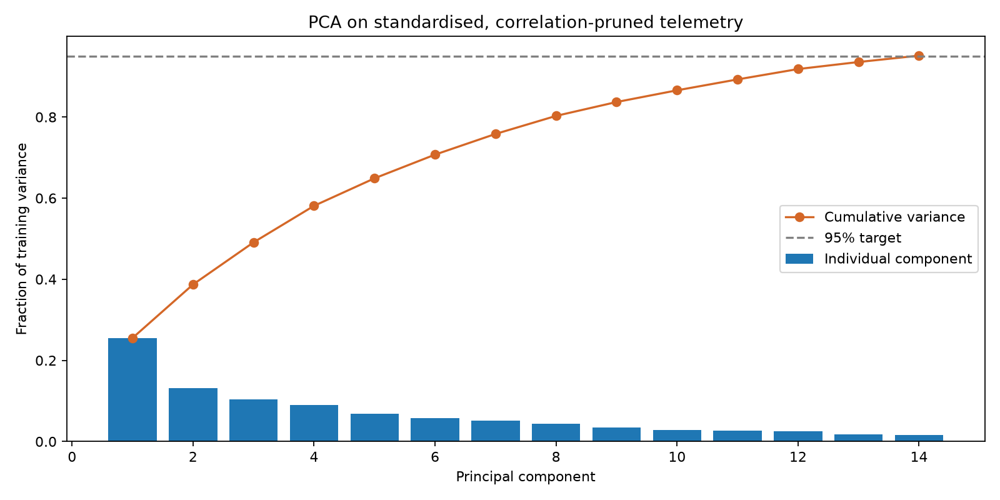

# Attribute reduction for the dump-truck simulator

## Scope and recommendation

Analysed **164,160 rows**, 960 configurations, 171 samples each, from the source CSV (unchanged).
Perception inputs excluded: **True**. When true, all GNSS/GPS, LiDAR, radar, DSS and camera-related columns are excluded before correlation, selection and PCA.
The request originally said 171 cycles; this existing dataset contains **171 samples in one 1,800 s journey**
per combination, not 171 independently simulated journeys. This analysis does not expand it.

**202 CSV columns are not 202 independent sensors.** After excluding outputs, configuration shortcuts,
diagnostic flags and constants, there are 76 numeric candidates,
74 after exact deduplication, and 33 after train-only |Pearson r| >= 0.95 pruning.

The validation-selected original-attribute set has **16 inputs**, a reduction of
**78.4%** relative to the 74 eligible nonduplicate inputs.
Use `reduced_attributes_dataset.csv` for an interpretable starting point. It contains metadata and targets
as well as inputs: load **only the input_columns in feature_schema.json as X**.
This is a recommendation for predicting **the simulator's health and RUL**, not a validated minimum
sensor set for physical trucks or for collision, braking, driver-safety or structural-failure detection.

## Recommended original attributes

| attribute | training_importance | health_pearson | rul_pearson |
|---|---|---|---|
| transmission.oil_pressure_kpa | 0.158 | 0.762 | 0.777 |
| engine.oil_temp_c | 0.088 | -0.635 | -0.624 |
| brake.pad_wear_pct | 0.049 | -0.396 | -0.407 |
| suspension.hydraulic_oil_condition_pct | 0.049 | 0.839 | 0.830 |
| suspension.shock_temp_c | 0.040 | -0.747 | -0.748 |
| brake.disc_temp_c | 0.038 | -0.737 | -0.751 |
| engine.oil_pressure_kpa | 0.037 | 0.375 | 0.369 |
| engine.coolant_temp_c | 0.020 | -0.373 | -0.353 |
| imu.vibration_rms_g | 0.015 | -0.553 | -0.550 |
| brake.stroke_pct | 0.008 | -0.152 | -0.154 |
| engine.block_vibration_mm_s | 0.007 | -0.653 | -0.677 |
| payload_utilization_pct | 0.005 | -0.553 | -0.530 |
| engine.fuel_level_pct | 0.004 | 0.308 | 0.300 |
| engine.exhaust_temperatures_c.1 | 0.004 | -0.396 | -0.382 |
| imu.yaw_deg | 0.004 | -0.087 | -0.074 |
| imu.angular_rate_y_dps | 0.003 | -0.205 | -0.194 |


Training importance is an ExtraTrees multi-output importance with both targets standardised, not
causal importance. Correlated alternatives may substitute for one another. Low single-variable
correlation does not imply a variable is unnecessary; fault interactions can be nonlinear.




## Correlation outputs

- `correlation_pearson.csv`: full matrix for the 74 eligible nonduplicate inputs.
- `correlation_spearman.csv`: rank correlations for the same inputs (nonlinear monotonic checks).
- `correlation_selected.csv`: smaller matrix for recommended attributes.
- `target_correlations.csv`: individual inputs vs health and RUL, kept separate from feature matrices.
- `high_correlation_pairs.csv`: strongly related pairs; `correlation_pruned.csv`: removed representatives.
- `column_audit.csv`: disposition of every original column; `exact_duplicates.csv`: exact repetitions.

All reported correlations and fitted transforms use **training rows only**. Correlations reflect the
synthetic generator and repeated fault variants; they do not establish real-machine causality.

## PCA dimensionality reduction

StandardScaler (train mean/std) -> PCA (train only) retains **14 components** and
**95.13%** of variance from 33 pruned inputs.
Inputs have different units (kPa, degrees, g, mm/s), so scaling is necessary.
`pca_weights.csv` contains component projection coefficients, not Pearson correlations.
`pca_variance.csv` records individual/cumulative variance.

**PCA reduces model dimensions, not sensor requirements.** Collect all 33 PCA input channels
in schema order to transform a new frame. Prefer original-attribute selection when the aim is fewer
measurements. Retaining 95% of variance does not guarantee retaining 95% of health-prediction information.



## Leakage-aware validation

No row-wise random train/test split. Group = **scenario + payload class**; both starts, all 32 fault
variants and all temporal samples stay together. Nine groups train, three validate, three test.
This prevents fault-counterpart rows from the same base configuration appearing in different splits.
Training rows: 98,496; validation: 32,832; test: 32,832.
ExtraTrees fits use a reproducible balanced 29,952-row training subsample (52 rows/configuration);
correlations/scaling/PCA use all training rows. Scores use every row in the relevant held-out split.
80 trees, depth <=18, minimum leaf 3, seed 42; both targets standardised for comparable influence.

Validation chooses subset size from 8/12/16/24/all correlation-pruned inputs (capped at available count).
The smallest subset within 10% of the best joint normalised validation MAE is selected before testing.
PCA uses the same downstream learner. Baseline predicts the training-target means.

### Validation comparison

| method | attributes | health_mae | health_r2 | rul_mae_hours | rul_r2 | confidence_macro_f1 |
|---|---|---|---|---|---|---|
| Full telemetry | 74 | 6.196 | 0.775 | 923.477 | 0.711 | 0.772 |
| Selected 8 | 8 | 8.864 | 0.644 | 1355.080 | 0.524 | 0.695 |
| Selected 12 | 12 | 7.144 | 0.719 | 1095.490 | 0.594 | 0.763 |
| Selected 16 | 16 | 6.569 | 0.763 | 967.952 | 0.689 | 0.767 |
| Selected 24 | 24 | 6.794 | 0.757 | 976.664 | 0.697 | 0.757 |
| Selected 33 | 33 | 6.976 | 0.750 | 1003.380 | 0.691 | 0.752 |
| PCA 95% | 14 | 7.119 | 0.741 | 1045.271 | 0.661 | 0.751 |


### Untouched test comparison

Health MAE is in **0–100 score points**; RUL MAE is in **hours**. Higher R²/F1 is better; lower MAE is better.

| method | attributes | health_mae | health_r2 | rul_mae_hours | rul_r2 | confidence_macro_f1 |
|---|---|---|---|---|---|---|
| Full telemetry | 74 | 7.763 | 0.590 | 1061.631 | 0.617 | 0.725 |
| Selected 16 | 16 | 8.074 | 0.568 | 1125.578 | 0.583 | 0.717 |
| PCA 95% | 14 | 8.484 | 0.533 | 1223.113 | 0.528 | 0.710 |
| Training mean baseline | 0 | 14.935 | -0.126 | 2110.358 | -0.066 | 0.191 |


Test groups: ideal|heavy, overhaul|medium, stress|light.
Validation groups: ideal|light, overhaul|heavy, stress|medium.

Confidence macro-F1 is computed by mapping predicted health to the existing High/Medium/Low rules;
confidence is **not an independently trained or calibrated probability**. The source percentage column
uses fixed values 90/75/55; these were assigned by the dataset generator, not estimated uncertainty.

## Limitations that matter for training

1. Health is generated by a hand-written penalty rule; RUL is an algebraic function of health plus
   scenario; confidence/classification are deterministic health bands. Good scores mean rule imitation,
   not verified failure prediction or remaining physical life.
2. Never feed health, RUL, confidence, their ranges/classes, actions, contribution factors, fault
   injection flags, active-fault count or operational-status labels into the prediction model.
3. A single seed and a single synthetic C-WTVC profile are present. Fifteen base groups are too few
   for a strong generalisation claim. The held-out scenarios use the same underlying simulator rules.
   Validate with new seeds, different routes, held-out fault mechanisms and ultimately actual failures.
4. Synthetic channels can be overly correlated. Oil-condition estimates, perception confidence and
   structural proxies require actual sensor/estimator support. Keep safety-critical sensors even if
   this health-target experiment ranks them low. Do not remove IMU/LiDAR/radar solely on these results.
5. The model currently uses coolant as a block-temperature proxy, plus separately synthesised vibration
   velocity in mm/s and acceleration in g. Those are not interchangeable physical measurements.
   Operational-band decisions and health-score decisions are separate rules and may disagree.
6. Selecting against two outputs cannot prove coverage for transmission, hydraulic or brake failure
   labels not independently tested here. This dataset also contains no independently observed failure times.

## Deliverables and reuse

- `reduced_attributes_dataset.csv`: all source rows, selected inputs, labelled targets and split metadata.
- `pca_dataset.csv`: same rows and targets, with fitted component scores.
- `feature_schema.json`: exact input/target/metadata lists.
- `pca_transform.joblib`: train-fitted scaler, PCA and required ordered columns.
- `selected_model.joblib`: demonstration model with target scaler and input list.
- `journey_splits.csv`, `model_comparison.csv`, `manifest.json`: reproducible split and evaluation evidence.

Joblib files are Python serialisations: load only these trusted locally generated files.
Full re-run from Engine:

```bash
uv run --with pandas==3.0.6 --with scikit-learn==1.9.1 --with matplotlib==3.11.2 python analysis/analyse_dataset.py
```
